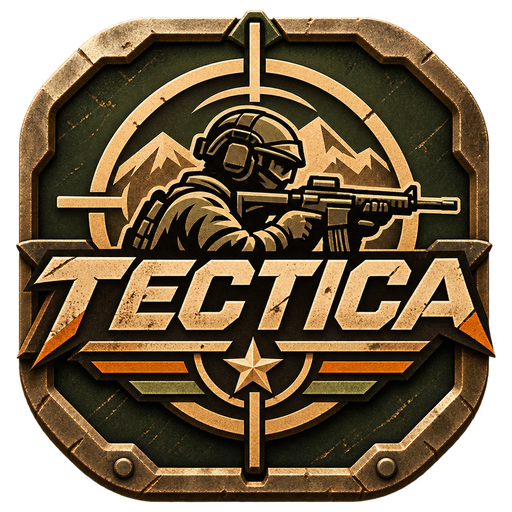
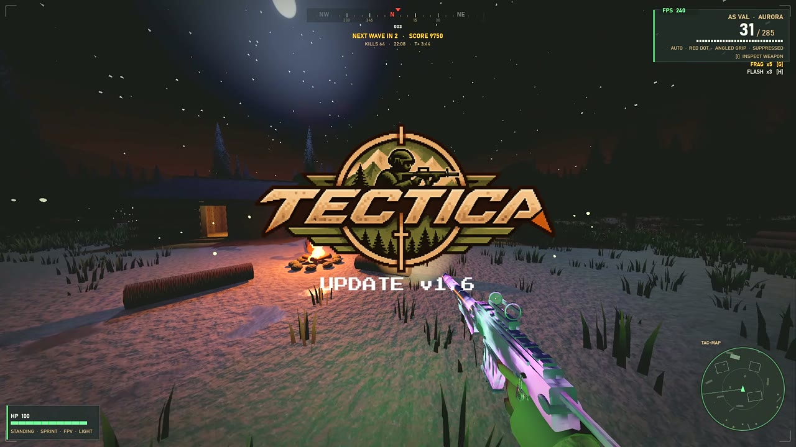
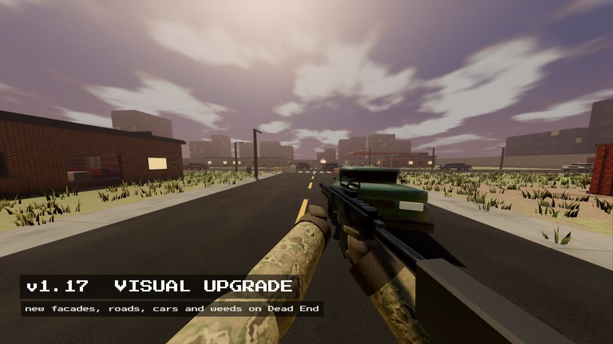
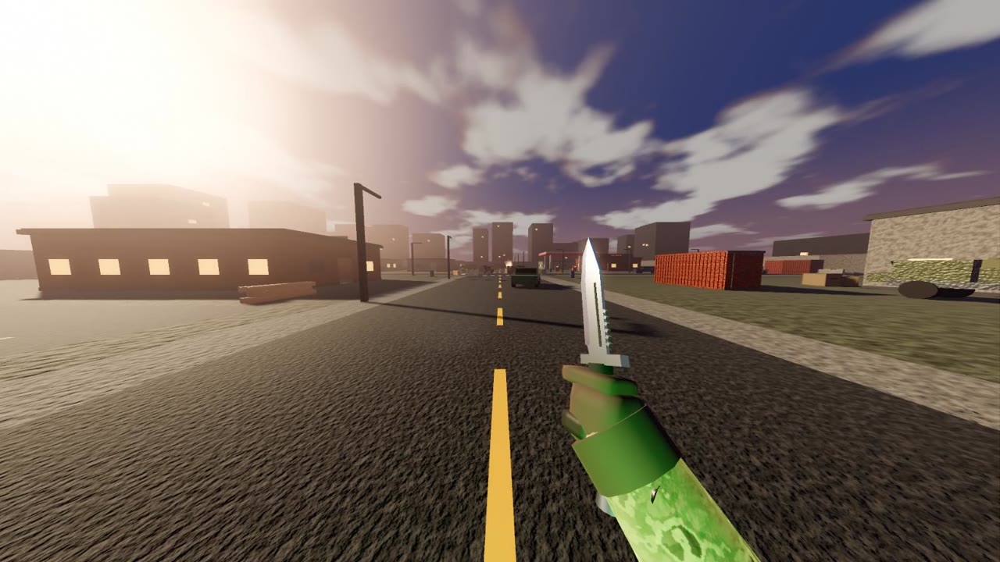
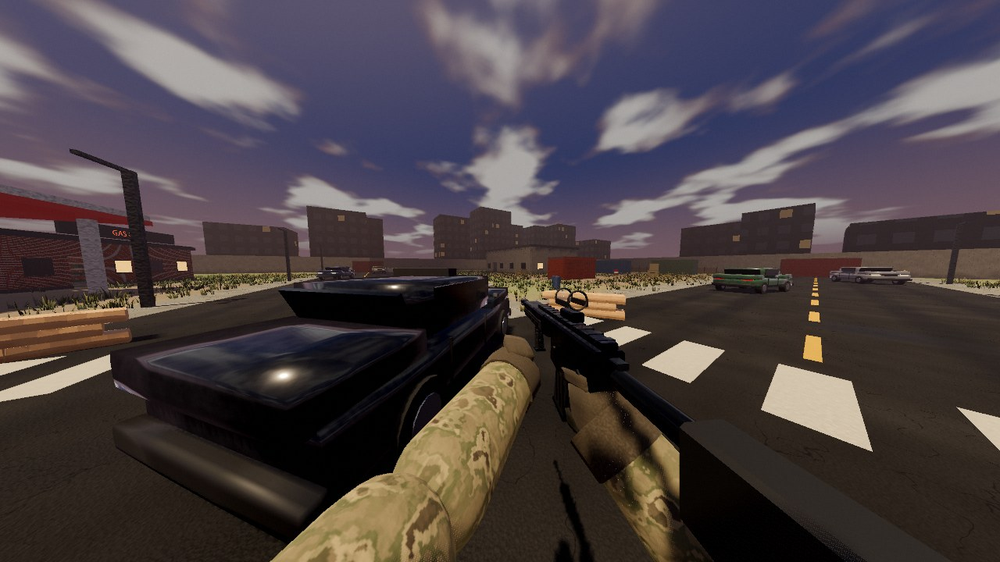
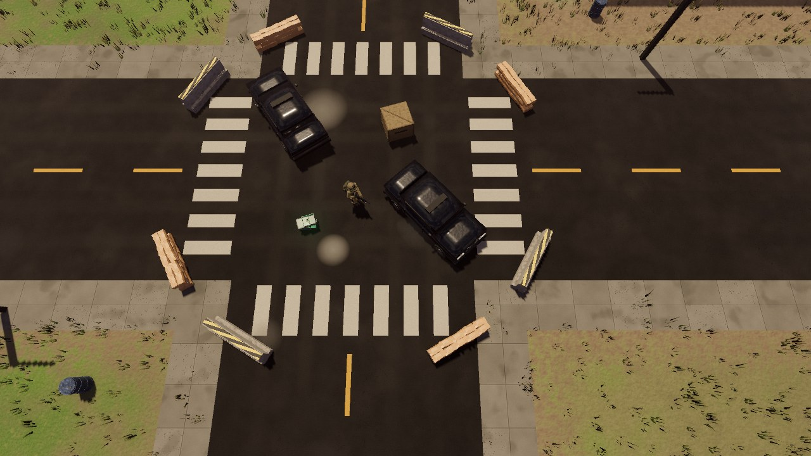
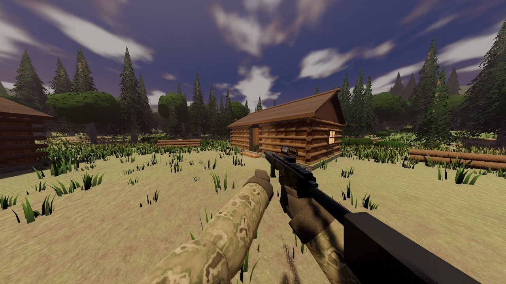

<p align="center"></p>

# TECTICA

A tactical military shooter for **Godot 4.7** (GDScript, Forward+), playable in top-down or first person —
campaign chapters, zombie survival, online co-op and PvP deathmatch.
Soldiers, most weapons, both maps, FX and sound are generated in code; a few props and two guns come from an optional asset pack.

## ▶ Promo video

[](https://github.com/Ai-Sukmoren/TECTICA/releases/download/v1.16.0-beta/TECTICA-promo.mp4)

*Click the image to watch the promo (MP4, 36 s).*

### 13 November update (v1.15 - v1.17)

[](https://github.com/Ai-Sukmoren/TECTICA/releases/download/v1.17.0-beta/TECTICA_v1.17_update_promo.mp4)

*Visual upgrade, running animation, knives, co-op zombies on every map and phone touch controls (MP4, 49 s).*

### Knife showcase (v1.16)

[](https://github.com/Ai-Sukmoren/TECTICA/releases/download/v1.16.0-beta/TECTICA-knife-showcase.mp4)

*Combat knife, karambit and butterfly knife with their inspect animations (MP4, 24 s).*

### Screenshots (v1.17 visual upgrade)

| Dead End, first person | Dead End, top-down | Pinewood Valley, first person |
|---|---|---|
|  |  |  |

*Brick, siding and plaster facades, worn asphalt and road paint, weeds, detailed cars, lit city skyline, matte helmets and leather boots, star-shaped muzzle flash.*

## ⬇ Download & play (Windows)

**[Download TECTICA for Windows (.zip)](https://github.com/Ai-Sukmoren/TECTICA/releases/latest/download/TECTICA-Windows.zip)**

1. Unzip the download anywhere and run **`TECTICA.exe`**.
2. If Windows SmartScreen warns about an *unknown publisher*, click **More info → Run anyway** (the game isn't code-signed).
3. Create an account (username + 4-digit password) — accounts stay on your PC and keep your credits, skins and progress.

Needs a 64-bit Windows 10/11 PC with a Vulkan-capable graphics card.

### Play together
- **Open rooms:** the host chooses **MULTIPLAYER → ONLINE · TAILSCALE FUNNEL** and hosts a match.
  Other players choose **OPEN ROOMS** and click the host's room. Joining players only need the game.
  The online host needs Tailscale with Funnel enabled. Rooms expire after 45 seconds without a host update.
- **Community service:** the room directory and global sign-in dashboard run on the owner's PC.
  That PC must stay awake, online, and signed into Windows. Updated clients report successful local
  sign-ins with the username, timestamp, game version, and a random installation ID. Offline reports
  are queued for retry. The global dashboard requires the owner's private key on the server PC.
- **Host:** **MULTIPLAYER**, then **HOST CO-OP** or **HOST PVP DEATHMATCH**. Your **join code** (5 characters, for
  example `B7AHG`) is shown on the multiplayer screen, in the top-left corner while you play, and under
  **Esc → COPY JOIN CODE**. Tell it to your friends.
- **Co-op zombies on any map:** on **HOST CO-OP**, press A/D (or ←/→) to pick a chapter or
  **ZOMBIE SURVIVAL** on any map (Pinewood Valley, Dead End). Friends who join load the same map.
- **PvP on any map:** on **HOST PVP DEATHMATCH**, press A/D (or ←/→) to pick Pinewood Valley or Dead End.
- **Join a friend:** **MULTIPLAYER → JOIN**, type the code, press **Enter**.
- A 5-character code works for friends on the **same Wi-Fi / network** or on the **same Tailscale network**
  (there is one code for each). The code is the host's address packed into a few letters; there is no lobby server.
- **Over the internet without Tailscale:** the host forwards UDP port 7777 on the router and uses
  **Esc → COPY INVITE LINK · INTERNET**, which also gives a 7-character code.
- **Online (Tailscale Funnel):** switch **CONNECTION** to *ONLINE*; the host needs [Tailscale](https://tailscale.com)
  with Funnel enabled and shares the invite link, friends need nothing extra.
- Invite links (`tectica://join/...`) and plain IP addresses still work in the JOIN row; Ctrl+V pastes.
- Join codes need the default port 7777. Windows asks once to allow TECTICA through the firewall: say yes on the host.
- Everyone must run the same version of the game.

### Weapon skins
Earn credits in play (kills, cleared waves, mission grades, PvP), then open supply packs in the **ARMORY** —
190 skins across 5 rarities. Credits can't be bought; there are no purchases.

## Run from source
> **Assets not in this repository.** The optional third-party packs under `assets/thirdparty/` (see Credits) and the
> sticker artwork under `assets/stickers/` are not redistributed here because their licenses don't allow it. The game
> runs without them: props, grenades and bodies fall back to the built-in procedural models, and the two pack weapons
> (MGP7, ZC57) need the Alstra pack copied into `assets/thirdparty/alstra_shooter_essentials/`.

Clone this repository, open the folder in Godot 4.7 and press F5, or:
```
git clone https://github.com/Ai-Sukmoren/TECTICA.git
godot --path TECTICA
```

## Controls
| Action | Keyboard / Mouse | Gamepad (Xbox layout) |
|---|---|---|
| Move | WASD | Left stick |
| Aim | Mouse | Right stick (twin-stick, light aim assist) |
| Fire / aim down sights | LMB / RMB | RT / LT |
| Sprint | Shift (hold) | L3 (toggle) |
| Vault low obstacle | Space (or sprint into it) | A (or sprint into it) |
| Peek left / right | Q / E | LB / RB |
| Crouch (slide while sprinting) | C / Ctrl | B |
| Reload | R | X |
| Inspect weapon (aim/fire cancels immediately) | I | - |
| Switch weapon | 1 / 2 / X | Y |
| Frag grenade | G | D-pad down |
| First person on/off | F | R3 |
| Rotate camera | Z / V | D-pad left / right |
| Zoom | Mouse wheel | D-pad up (cycle) |
| Debug panel / pause | F1 / Esc | Back / Start |
| Graphics preset (Low/High/Ultra) / music | F2 / M | - |
| Restart (after mission) | Enter | A |

The game switches between mouse and gamepad automatically, depending on which you touched last. Gamepads also rumble on shots, hits and landings.

The title menu sets view mode, graphics and music. Music is generated at startup and crossfades from an ambient track to a combat track when enemies engage you.

Green ammo cans resupply ammo and +35 HP.


## Tactical systems
- **Frag grenades** for you (2 in Operation, 3 in Zombie; ammo cans give +1, each cleared wave gives +2) and for the enemy AI, which lobs them at your last known position when you hide behind cover. Blasts are blocked by walls and cover, and an incoming grenade triggers an on-screen warning with its direction.
- **Stealth by sound**: footsteps are audible. Sprinting near guards makes them suspicious, while walking, aiming or crouching is silent. Gunfire (unless suppressed) and explosions alert everyone nearby.
- **Health regeneration** after 5 s without taking damage (up to 100 in Operation, 70 in Zombie).
- **Feedback**: red arcs point toward whoever hit you; hit and kill sounds; a heartbeat, muffled audio and drained colour at low health.
- **Mission grade** (S/A/B/C) in Operation, scored on time, accuracy, headshots and damage taken.
- **Pause menu** (Resume / Settings / Restart / Quit to title) and **Settings** (sensitivity, first-person FOV, master/music/effects volume, camera shake, FPS counter, film grain, V-Sync), saved to `user://settings.cfg`.

## Campaign (chapters 1 and 2)

Pick a chapter under **MODE** on the title screen. Finishing Chapter 1 goes
straight into Chapter 2 (Enter / A). Best grades are saved to
`user://campaign.cfg`.

| Chapter | Time | Objectives |
|---|---|---|
| 1. TIMBERLINE | 08:00 → day | Infiltrate the logging camp → eliminate the garrison → **hold F** to download the intel → exfil to the river crossing |
| 2. NIGHTFALL | 20:36 → night | Infiltrate the radio outpost → plant a charge on the **generator** (all floodlights and the searchlight die) → blow up the **radio tower** (it topples) → reach the LZ → hold it against two enemy waves until the helicopter lands |

The current objective is shown at the top of the screen with an on-screen
waypoint, its distance, and a marker on the minimap.

## Pinewood Valley (the map)

A 200 × 200 m forest with:

- more than 1,100 pine and broadleaf trees, plus bushes, wind-blown grass,
  boulders and fallen logs;
- dirt roads, and a creek with a log bridge;
- the logging camp (cabins, sawmill, campfire, watchtower);
- the radio outpost (HESCO walls, a radio tower, a generator, a bunker,
  tents, a searchlight tower);
- two helicopter landing zones and a ruined hunter's cabin with supplies.

Trees and rocks stop bullets and give cover (the AI uses them too). Crouching
inside a bush makes you much harder to spot. In top-down view, treetops and
roofs near you turn see-through.

## Day / night

A real-time cycle (one in-game hour per real minute):

- the sun moves across the sky and turns golden at sunrise and sunset;
- at night a moon and stars come out, with morning mist;
- camp lamps, the campfire and the outpost floodlights switch on at dusk.

At night enemies see much less far, unless your flashlight (**T** / Back) is
on. Enemies carry weapon lights after dark. Zombie mode starts at a blood-red
dusk.

## Destructible environment

Crates, crate stacks, sandbags, barrels, concrete barriers, desks, shelving and
the map table can all be destroyed. Bullets chip them, knock loose small pieces
(bags, boards, ammo boxes) and make them sag. Frag grenades wreck them.
Sandbags shrug off most rifle fire, and concrete barriers need explosives.
Red barrels explode and chain-react. A destroyed prop bursts into physics
fragments, its AI cover points and radar outline are removed, and the
navigation mesh re-bakes so soldiers and zombies path through the gap.
Containers, the truck and walls stay solid.

## Settings

The Settings screen (title menu or pause menu) has three tabs:
**GAME / VIDEO / AUDIO**. Switch tabs with Q/E or LB/RB.

- **VIDEO:** quality preset (LOW, HIGH, ULTRA, or CUSTOM once you change an
  option), first-person FOV (60–110°), top-down FOV, render scale (FSR below
  100%), anti-aliasing (FXAA, MSAA 2x/4x, TAA), shadows, ambient occlusion,
  reflections, SSIL, global illumination, volumetric fog, bloom, brightness,
  retro CRT filter, film grain, display mode, frame-rate limit and V-Sync.
- Everything saves to `user://settings.cfg`.

## Retro theme

UI text uses pixel fonts: Pixelify Sans for body text and Press Start 2P for
headlines, both under the SIL Open Font License (see `assets/fonts/`). The UI
uses a phosphor-green / amber palette, and an optional CRT scanline overlay
sits on top of everything.

## Game modes
- **Operation**: clear the compound of 10 hostiles. Enemies use cover, peek, flank and alert each other.
- **Zombie Survival**: endless waves of infected soldiers (walkers, runners from wave 2, armored brutes from wave 4).
  Each wave has 6 + 4n zombies with about 18% more health per wave. Spawns slow down when your HP is low.
  Between waves you get +35 HP and an ammo refill. The run ends when you die, and your best wave and score are recorded.

## Guns, attachments and classes
Pick **LOADOUT** on the title menu to open the **Gunsmith**. A/D on the menu row switches class.

| Primary | Type | Notes |
|---|---|---|
| M4A1 | Assault rifle | All-rounder |
| AK-47 | Assault rifle | Hard-hitting, heavy recoil |
| AS VAL | Assault rifle | Integrally suppressed |
| MP7 | SMG | Fast handling, fast fire rate |
| AWP | Sniper | Bolt-action, 120 damage, 8x scope with scope overlay |
| M870 | Shotgun | Pump-action, 8 pellets |
| M249 | LMG | 100-round box, bipod |

Secondaries: **MK23**, **Glock 18** (full auto).

Attachment slots (options depend on the gun):
- **Optic**: iron, red dot, holo, ACOG 4x, 8x scope
- **Muzzle**: suppressor, compensator, flash hider, muzzle brake, choke
- **Underbarrel**: vertical grip, angled grip, laser, bipod
- **Magazine**: extended, drum, fast
- **Stock**: light, heavy

Every attachment changes the real stats: damage, fire rate, range, accuracy, recoil, mobility, ADS speed, magazine size, reload time and noise.

Classes: ASSAULT, RIFLEMAN, RECON, CQB, BREACHER, SUPPORT, SPEC OPS. Each is fully editable and saved to `user://loadout.cfg`.

## Structure
```
project.godot             Godot 4.7 project (Forward+; the web build uses Compatibility)
export_presets.cfg        Windows Desktop and Web exports (to ../builds/)
scenes/                   main.tscn, loading screen
assets/                   icon, logo, fonts, skins; assets/thirdparty/ is local-only (see Assets)
scripts/
  main.gd                 bootstrap, environment, rules, signals
  core/                   input map + rebinding, settings, accounts, loadout, progression, platform (phones)
  characters/             soldier rig (procedural animation), player, AI enemies, infected, creatures
  weapons/                weapon data, procedural gun and knife models, hitscan + melee
  world/                  forest and town maps, terrain, nature, destructibles, time of day
  modes/                  campaign, zombie wave director
  net/                    multiplayer sync, join codes, open-room service client
  skins/                  weapon skins, outfits, stickers, charms, collection
  camera/  fx/  audio/    camera rig, effects + synthesized sounds, adaptive music
  ui/                     HUD, menus, armory, gunsmith, touch controls, kill cam
tests/                    automated tests (run them all with tools/run_tests.py)
  previews/               windowed screenshot / render tools (not run automatically)
  perf/                   benchmarks
tools/                    test runner, community server, asset helpers
docs/screenshots/         development screenshots
```

## Tests
```
python tools/run_tests.py            # every automated test, with a pass/fail summary
python tools/run_tests.py knife      # just the tests whose name contains "knife"
godot --headless --path . -s res://tests/smoke_test.gd    # one test by hand
```
Set the `GODOT` environment variable to the Godot 4.7 executable if `godot` is not on PATH.
Tests save into a separate sandbox (`user://test_sandbox/`), never into real accounts.

## Animation system
`soldier_rig.gd` animates a segmented rig procedurally instead of using AnimationPlayer clips:
- **Locomotion blend space** from local velocity: idle breathing, walk, strafe, backpedal, jog, sprint, crouch walk, turn-in-place shuffle.
- **Independent facing**: legs follow movement and the torso follows the aim, with the twist split between spine and chest.
- **Two-bone IK** for legs (gait cycle foot placement) and arms (hands locked to the weapon grip and handguard).
- **Planted-foot gait**: stance/swing phases with stride sized to ground speed (no foot sliding), heel-off and toe-lift, walk vs run hip bob.
- **Peek**: hips shift, spine/chest roll around the aim axis, head tilt and weapon cant; shots and enemy line-of-sight use the leaned position, clamped against walls.
- **Vault**: side vault with a left-hand plant on the obstacle (IK), tucked legs, rifle swung clear, landing dip and forward lurch.
- Weapon inertia (lags and cants when turning fast), acceleration/stop lean, hip bob and sway, spring recoil, hit-reaction springs, keyframed reload hand paths (mag drop on empty reload, retention on tactical), weapon lower/raise switching, a directional death fall and a dropped physics weapon.

To use mocap/Mixamo characters instead, replace the rig with an imported Skeleton3D + AnimationTree, and keep the same input properties (`move_velocity`, `aim_yaw`, `crouch_target`, `aim_target`, `sprint_target`).

## Responsiveness and performance
High is the default graphics preset; F2 cycles Low / High / Ultra. Ultra retains
screen-space indirect lighting and SDFGI for machines with more GPU headroom.
Mouse look uses unaccumulated, screen-relative input. First-person animation and
camera rendering share the same interpolated body position; ADS removes cosmetic
weapon bob and turning sway while preserving firing recoil.

Rendered checks (run without `--headless`):
```
godot --path . -s res://tests/perf/render_benchmark.gd -- 1
godot --path . --max-fps 144 -s res://tests/aim_stability_test.gd
```
The benchmark samples 360 frames after 120 warmup frames at the fixed title view;
it reports frame time, p95 and draw calls, not a combat FPS guarantee.

First-person impact feedback no longer rotates the eye or offsets the camera
projection; damage remains visible in the HUD and body reactions. Dynamic damage
lens fringing is disabled in first person. Weapon recoil and deliberate peeking
remain active. `tests/camera_motion_test.gd` exercises real player movement through
sprint, moving ADS and walking while injecting repeated impact feedback, and checks
the camera's effective render transform (including projection offsets).

The forest visual polish pass adds drifting cloud banks, anisotropic filtering
for nature materials, corrected terrain/water normal blending, and more readable
weapon metal. Film grain is subtler; disabling lens effects now fully bypasses
the lens pass when no desaturation is needed. Camera behavior is unchanged.

The river uses one continuous curved channel, a shallow recessed terrain bed,
flow-aligned ripple normals, translucent banks and broken shoreline foam.
The bridge crossing remains level. All cabins, the comms bunker, sawmill shed,
watchtower shelters, tent entrances and supply ruin have light fixtures. Interior
lights stay on during daytime; outpost interior lights follow generator power.
`tests/previews/river_lighting_check.gd` checks daytime/nighttime lamps, generator shutdown
and navigation across the river, and captures river/room previews.


## Infected roster and animation polish
- Crawler (from wave 3): low crouched silhouette, ground-reaching hands, smaller
  collider and lower health. Aim down at it before it closes the distance.
- Armored (from wave 5): blue-gray armor with a yellow chest stripe. Frontal torso
  hits deal 40% damage; headshots, legs and attacks from behind bypass the plate.
- Berserker (from wave 6): red uniform and shoulder growths that glow when health
  reaches 50%. Rage increases movement speed by 55% and melee damage by 30%.
  A groan and glowing growths announce rage; host snapshots replicate the state.
The original walker, runner and brute remain. New types replace part of the wave
mix rather than increasing the total enemy count. Wave callouts explain threats.
Zombies now check walls both before beginning melee and when the hit lands.

All procedural character rigs now share the same render interpolation path.
Movement samples are smoothed before acceleration drives torso lean. Animation
integration advances in small steps rather than discarding elapsed time below
30 FPS, keeping reload, switch, vault, attack and death clocks consistent. Air
pose blending uses the same timestep; aligned IK targets have a stable fallback.
First-person camera recoil rules and steady sight alignment remain intact.

Balance posture: all new unlocks, weights, stat multipliers and the 14/s animation
velocity smoothing rate are starting values, not playtest-certified difficulty.
Automated checks cover unlock eligibility, front/back/head damage, rage flags,
crawler collision, wall occlusion and attack timing at 15/30/60/144 FPS. Manual
acceptance: recognize each type before contact, evade a crawler, flank armor and
finish a wounded berserker without an unavoidable hit. If late waves become
unavoidable, reduce special-type weights/rage speed; if a type is irrelevant,
increase its weight before increasing damage. If starts/stops visibly lag the
body, increase the animation smoothing rate; reduce it if torso impulses remain.

Run `godot --headless --path . -s res://tests/zombie_variants_test.gd` for the
new behavior/timing checks. A client snapshot test covers rage state; a real
multi-computer multiplayer session still needs manual playtesting.

## Credits

- Characters: Quaternius — Ultimate Modular Characters / Universal Base Characters (CC0).
- MGP7 SMG, ZC57 pistol, M67 grenade, sandbags, fuel barrels, ammo cans, med kits, radios and other props:
  **Alstra Infinite** — PPS Shooter Essentials (alstrainfinite.itch.io/pps-shooter-essentials),
  used under the Alstra Infinite license (alstrainfinite.com/fal).
